# Frontend refresh — review notes

Presentation-only redesign of the private wallet and its public pages. No Python views,
URLs, models, API calls, cryptography, intake logic or status computation changed.

Each image is **before (left) · after (right)**. Both sides were rendered from the real Django
templates with the same fictional fixtures (`tools/frontend-preview/`).

| Screen | Comparison |
|---|---|
| Home (desktop) | 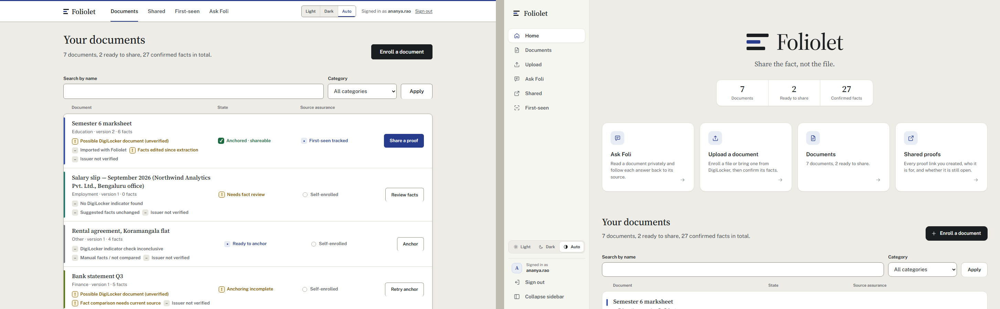 |
| Document detail | 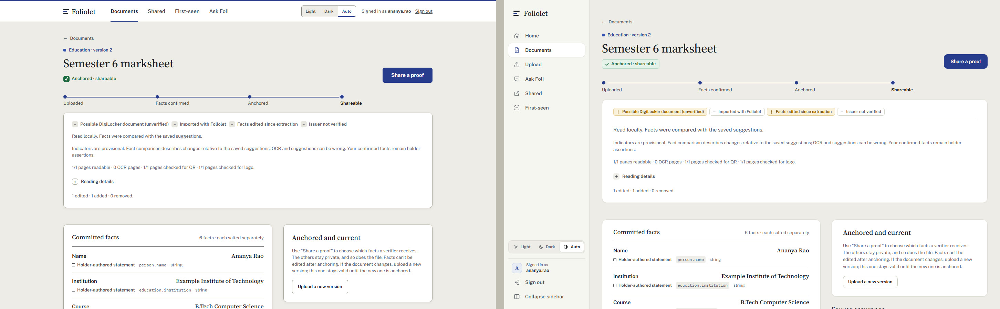 |
| Fact review (draft) | 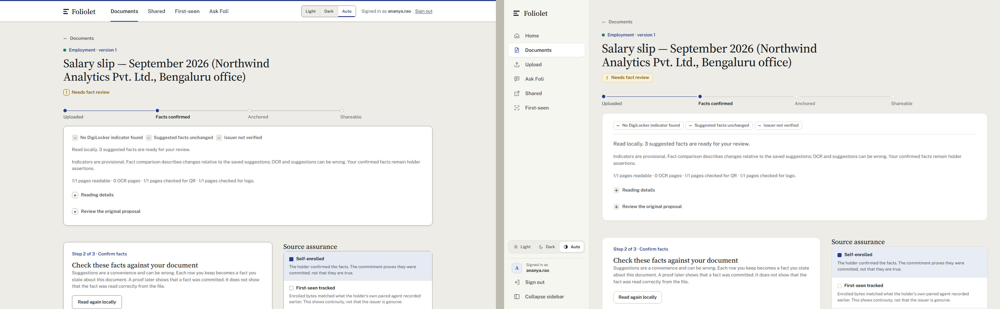 |
| Upload and DigiLocker intake | 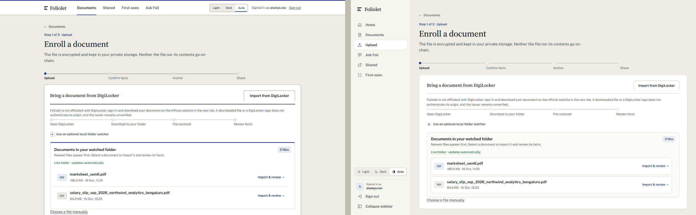 |
| Ask Foli | 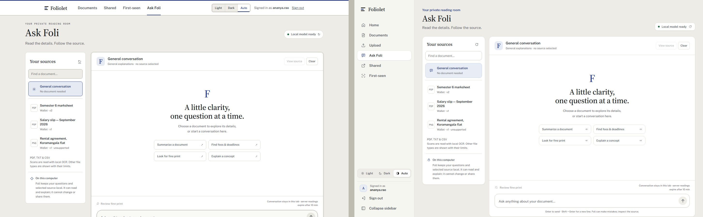 |
| Share a proof | 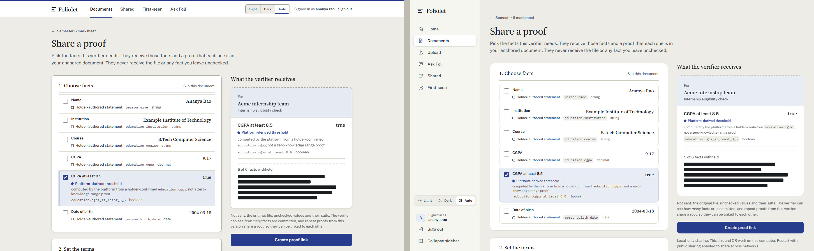 |
| Shared | 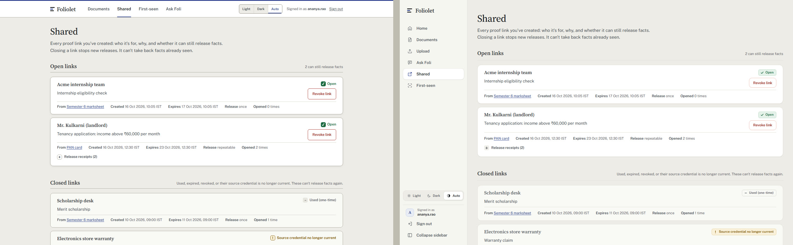 |
| Public verifier (no private navigation) | 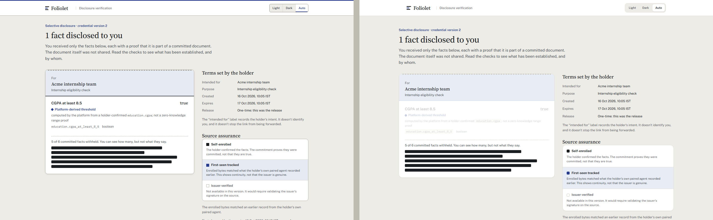 |
| Sign in (no private navigation) | 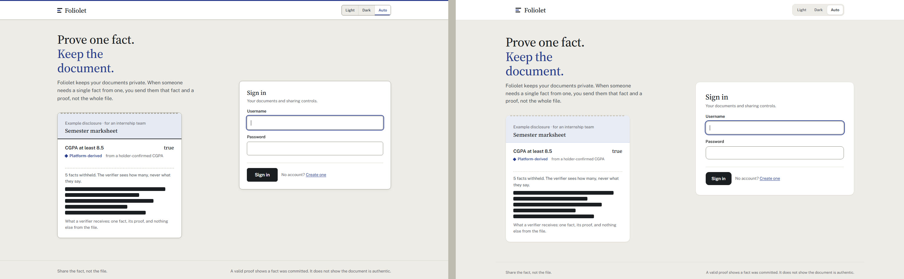 |
| Home, dark | 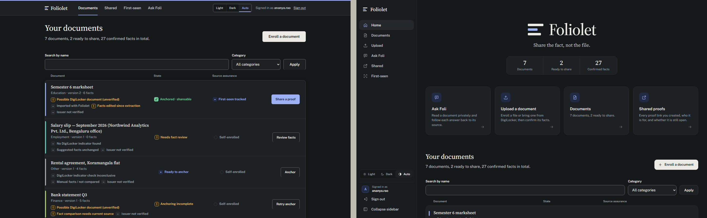 |
| Detail, dark | 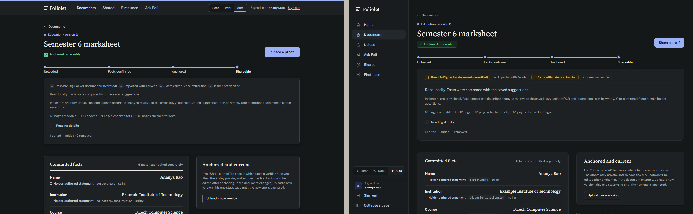 |
| Home, phone | 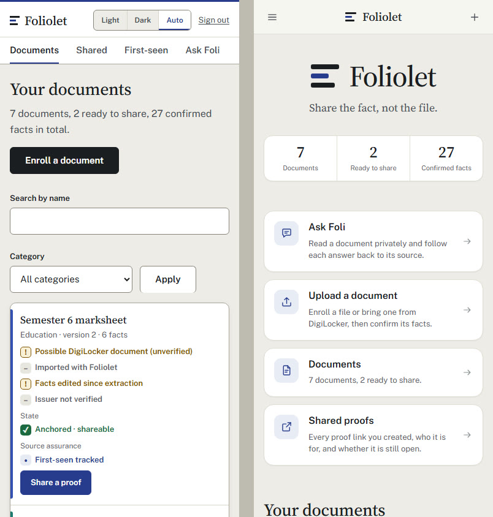 |
| Detail, phone | 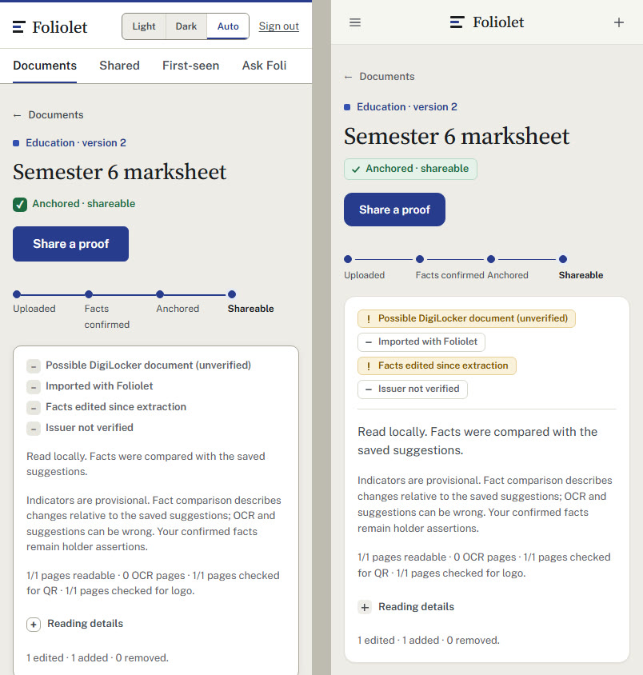 |
| Home, tablet | 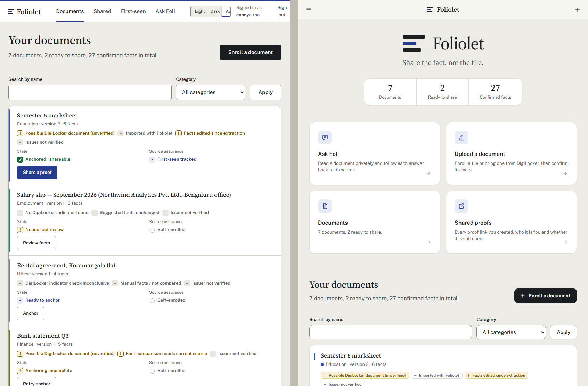 |
| Collapsed sidebar | 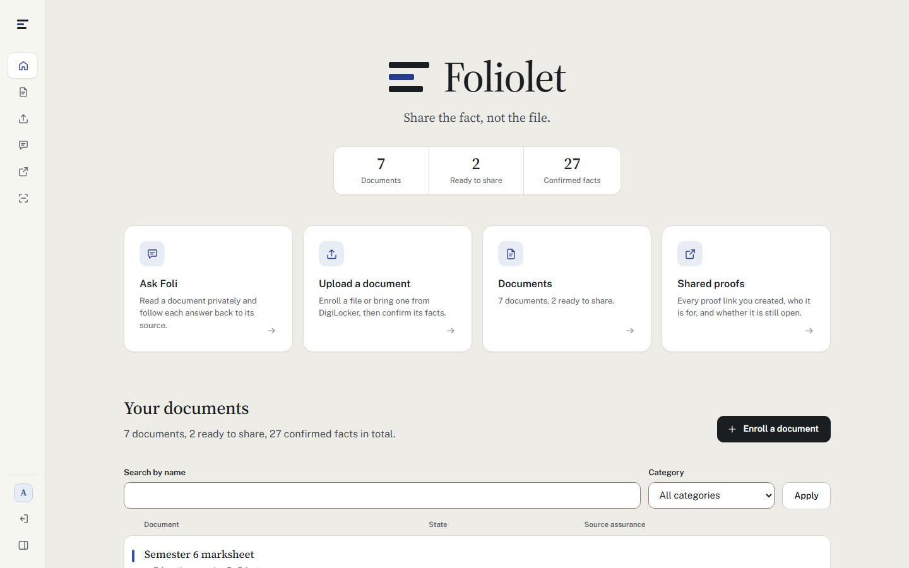 |
| Collapsed sidebar, detail | 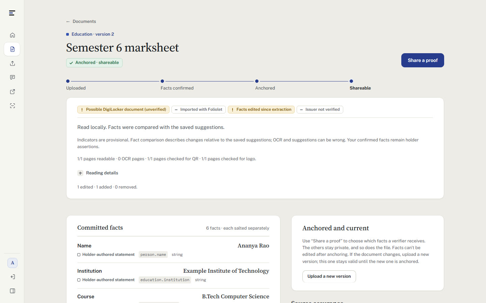 |

## What changed

- **Shell.** Signed-in pages use a left sidebar (Home, Documents, Upload, Ask Foli, Shared,
  First-seen; theme, account and a POST Sign out at the foot). It collapses to an icon rail
  with tooltips, remembers the choice before first paint, and becomes a drawer under 900px
  (Escape, scrim and close button dismiss it; the page is `inert` while open). Sign-in,
  registration, public verification and receiver pages keep their own header.
- **Home.** The authenticated index is a product home: the Foliolet mark and wordmark, three
  real counts from the existing context, four quick-access tiles, then the unchanged document
  register at `#documents` (search and category filters keep their GET fields).
- **System.** Softer radii and borders, lighter shadows, one line-icon family (inline sprite,
  no external assets), status marks as compact glyph-plus-word tags whose tone comes only from
  the existing class, notices with status glyphs, quieter tables and ledgers.
- **Motion.** Same-origin page loads cross-fade (`@view-transition`, progressive), the sidebar
  stays still across navigations, lists settle in once. `prefers-reduced-motion` removes all of it.

## Preview it without touching a running instance

```bash
python -m venv .venv-preview
.venv-preview/Scripts/python -m pip install "Django==6.1.2"
.venv-preview/Scripts/python tools/frontend-preview/render.py <OUT_DIR>
python -m http.server 8772 --bind 127.0.0.1 --directory <OUT_DIR>
```

Pick any free loopback port. The preview needs no Spring Boot, database, chain, model or
session; client scripts read small fictional JSON stubs written next to the pages.
